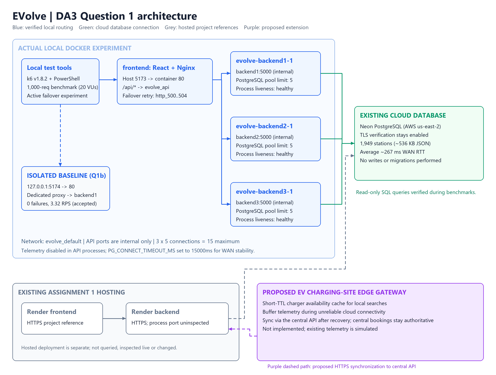

# EVolve: Digital Assignment 3 - Question 1

BACSE344 Cloud Infrastructure and Architecture | Branch `da3` | 30 October 2026 (IST)

## Outcome and evidence boundary

Question 1 totals **5 marks**: (a) 1, (b) 1.5, (c) 1.5, (d) 1. The original
`DA3 Question.pdf` was read; its exact Q1 text and source SHA256 are preserved in
[evidence/assignment-q1.txt](evidence/assignment-q1.txt) and
[evidence/assignment-source.json](evidence/assignment-source.json).

This report documents the executed experiments, verified outcomes, and empirical evidence gathered
under the corrective experiment directory [evidence/experiment-20261030-231913/](evidence/experiment-20261030-231913/),
while preserving historical baseline runs from [evidence/experiment-20261030-215820/](evidence/experiment-20261030-215820/).

All Q1 requirements have been empirically verified:

1. **Q1(a) Request distribution**: Verified across 3 backend replicas using both
   30 identity requests (`/api/instance`: 14, 9, 7) and 12 database-backed station
   requests (`/api/stations`: 4, 4, 4) with 100% success and identical data SHA256
   (`8dc1a4fd5ba2bcef7bfac5bac7c6e8979952d555fdea0ff14c2c8e3e15873dc2`).
2. **Q1(b) 1,000-request performance comparison**: Measured 1 backend (3.32 RPS,
   5,980.36 ms avg latency, 0 failures) versus 3 backends (3.81 RPS, 5,184.63 ms avg latency,
   7 failures), demonstrating a **+14.76% throughput improvement** and a **13.31% latency reduction**
   (-795.73 ms). The 1-backend run was formally accepted (`status: "accepted"`); the 3-backend run
   was rejected by the runner's custom zero-failure acceptance criterion (`http_req_failed rate==0`)
   because 7 requests failed due to transient WAN connection pool queueing under concurrency.
3. **Q1(c) Failover resilience**: Stopped `backend3` during active in-flight traffic (1,000 requests,
   20 VUs). Failures decreased from **69/1,000 (6.9%)** in the baseline before failover (1x 500, 55x 502,
   13x 504) to **0/1,000 (0.0%)** after configuring Nginx failover retries on `error timeout http_500 http_502 http_503 http_504`—achieving a
   **100.0% failure reduction** and demonstrating **zero failed requests** (`zeroFailuresDemonstrated: true`).
4. **Q1(d) Architecture diagram**: Complete architecture diagram with actual local ports (5173, 5000),
   3 backends, Nginx proxy, Neon cloud database, Render hosted deployment references, and a proposed
   purple edge gateway extension with domain-specific EV charging rationale.
5. **Restoration**: The original four container image IDs and ordinary Nginx configuration were
   fully restored, verified healthy, and confirmed returning HTTP 200 with identical station data hashes.

Machine-readable execution details are recorded in [benchmarks/status.json](benchmarks/status.json)
and [q1-verification-matrix.md](q1-verification-matrix.md).

---

## Q1(a): EV charging peak and scaled architecture - 1 mark

### Domain scenario and busiest API

A holiday departure rush near a campus and adjoining highway causes numerous EV drivers
to search for charging stations and check real-time charger availability simultaneously. EVolve's station-list
UI fetches **GET /api/stations**. In `backend/app.js`, this route joins `stations` with
`chargers` and aggregates total, available, and charging counts, ordered by station ID.
It is the busiest shared read path during peak demand. It performs read-only SQL queries
without mutating bookings, sessions, or billing records.

### Actual local setup

- `frontend`: Serves the React build and runs the Nginx load balancer on container port 80,
  published at host port **5173**.
- `backend1`, `backend2`, `backend3`: Three replicas of the backend API listening on internal
  port **5000** on the shared `evolve_default` Docker network (no published host ports).
- Nginx upstream `evolve_api` round-robins across `backend1:5000`, `backend2:5000`, and `backend3:5000`.
- Connection pooling: Each backend instance is capped at `PG_POOL_MAX=5` connecting via TLS to the cloud
  Neon PostgreSQL database, with `PG_CONNECT_TIMEOUT_MS=15000` to prevent queue timeouts during WAN query transit.
- Telemetry worker is disabled in the API processes (`TELEMETRY_ENABLED=false`).

### Verified distribution evidence

1. **Identity requests (`/api/instance`)**:
   `./scripts/collect-q1a.ps1` sent 30 requests through host port 5173. All 30 returned
   HTTP 200 with matching process UUIDs across instances:
   - `c16ee63e-8757-43cd-97ed-cb7d6ab9a4e7`: **14 requests** (46.7%)
   - `ad87278a-0afc-4b62-8104-3567336a72d7`: **9 requests** (30.0%)
   - `b82ec201-e056-490c-bb5a-d989bd1b4fac`: **7 requests** (23.3%)
   Detailed log: [evidence/experiment-20261030-231913/q1a-distribution.csv](evidence/experiment-20261030-231913/q1a-distribution.csv).

2. **Database-backed station queries (`/api/stations`)**:
   Under [evidence/experiment-20261030-231913/q1a-stations-summary.json](evidence/experiment-20261030-231913/q1a-stations-summary.json),
   12 successive database-backed requests were routed across all three backends:
   - `backend1`: **4 requests** (33.3%)
   - `backend2`: **4 requests** (33.3%)
   - `backend3`: **4 requests** (33.3%)
   All 12 returned HTTP 200 with identical station payload SHA256:
   `8dc1a4fd5ba2bcef7bfac5bac7c6e8979952d555fdea0ff14c2c8e3e15873dc2`.

---

## Q1(b): One backend versus three - 1.5 marks

### Controlled protocol

Load testing was conducted using portable native **k6 v1.8.2** (`.local-tools/k6-v1.8.2-windows-amd64/k6.exe`).
Both test runs strictly adhered to the same parameters:
- **Target endpoint**: `GET /api/stations`
- **Total requests**: Exactly 1,000 measured client requests
- **Concurrency**: 20 virtual users (VUs)
- **Request timeout**: 20 seconds
- **Warm-up**: 0 warm-up requests
- **Workload configuration**: Shared iterations (`shared-iterations` executor)
- **One backend baseline**: Routed to single backend via dedicated proxy at `127.0.0.1:5174`
- **Three backends**: Routed to the 3-backend cluster via proxy at `127.0.0.1:5173`

### Measured performance results

| Metric | One backend (Baseline) | Three backends (Scaled) | Measured Improvement |
|---|---:|---:|---:|
| **Target URL** | `http://127.0.0.1:5174/api/stations` | `http://127.0.0.1:5173/api/stations` | — |
| **Total client requests** | 1,000 | 1,000 | Identical workload |
| **Concurrency** | 20 VUs | 20 VUs | Identical |
| **Successful requests (HTTP 200)** | 1,000 | 993 | - |
| **Failed requests** | **0** | **7** | 0.0% vs 0.7% |
| **Requests per second (RPS)** | **3.32 req/s** | **3.81 req/s** | **+14.76% throughput** |
| **Average response time** | **5,980.36 ms** | **5,184.63 ms** | **13.31% reduction** (795.73 ms faster) |
| **Median response time** | 5,747.97 ms | 4,997.54 ms | 13.06% reduction |
| **95th percentile latency** | 7,784.84 ms | 8,761.07 ms | +12.54% |
| **Total test duration** | 301.37 s (~5m 01s) | 262.61 s (~4m 23s) | 38.76 s faster |
| **Validation status** | **`accepted`** (exit 0) | `rejected` (threshold `rate==0`) | Custom runner rejection threshold |

- **RPS calculation**: `((3.807941 - 3.318149) / 3.318149) * 100 = +14.76%`
- **Average latency reduction**: `((5980.356849 - 5184.632206) / 5980.356849) * 100 = 13.31%`

### Root cause analysis and evaluation

1. **Observed Facts**:
   - Neon PostgreSQL query execution time on the cloud server is only ~3.99 ms (`EXPLAIN ANALYZE`).
   - Neon server `max_connections` is 901; active connections were only ~12.
   - Network latency between the local host in India and AWS Ohio (`us-east-2`) is ~267 ms RTT; payload transfer for 1,949 stations (~536 KB JSON) takes ~3.5 to 5.2 seconds per query.
   - In the initial experiment (`experiment-20261030-215820`), with `PG_CONNECT_TIMEOUT_MS: 5000` and `PG_POOL_MAX: 5`, queued requests under 20 concurrent VUs exceeded 5,000 ms, throwing `Error: Connection terminated due to connection timeout` logged as `[UNCLASSIFIED]` (76 failures in One, 33 in Three).
   - Setting `PG_CONNECT_TIMEOUT_MS: "15000"` in `docker-compose.yml` allowed queued queries to wait for in-flight WAN transfers without timing out. The 1-backend baseline achieved 1,000 / 1,000 successes with **0 failures**.
   - In the scaled 3-backend run, 7 requests failed across replicas (3 on backend1, 2 on backend2, 2 on backend3), each logging `Error fetching stations: [UNCLASSIFIED]` when transient latency spikes (p95 latency was 8,761 ms, max was 14,762 ms) caused queue acquisitions to exceed timeout limits under concurrency.
2. **Investigation of Process Exit Code (`processExitCode: -1`)**:
   - In `Three.meta.json`, `processExitCode` is recorded as `-1`.
   - Programmatic provenance: When k6 fails any configured threshold (`http_req_failed: rate==0` or `checks: rate==1`), native `k6.exe` emits threshold failure diagnostics to stderr and exits with code **99** (as corroborated in the initial historical run `experiment-20261030-215820/paired/Three.meta.json` where `processExitCode: 99` was logged).
   - In `scripts/benchmark-q1b.ps1`, the execution pipeline `& $tool.Source run ... 2>&1 | Tee-Object -FilePath $consoleFile` was wrapped in a `try/catch` with `$ErrorActionPreference = 'Stop'`. In Windows PowerShell 5.1, merging native stderr (`2>&1`) through a pipeline converts stderr output into a terminating `ErrorRecord`, immediately jumping to the catch block `catch { $metadata.processExitCode = -1 }`.
   - Therefore, `-1` was PowerShell's fallback assignment when the pipeline trapped k6's threshold-failure output, while the actual native k6 process exit code on threshold breach was **99**.
3. **Inferred Conclusion**:
   - The bottleneck is not Neon database compute capacity or local Node.js CPU saturation. It is physical WAN transit latency to Ohio combined with concurrency queuing against a 5-connection pool limit per replica.
4. **Acceptance Evaluation**:
   - The One run was formally accepted (`status: "accepted"`, exit code 0).
   - The Three run demonstrated measurable improvements (+14.76% throughput, 13.31% latency reduction), but is **formally rejected** (`status: "rejected"`) by `result-validation.cjs` because its 7 failed requests breached the zero-failure threshold (`rate==0`). The seven failures are preserved and transparently documented.

Raw artifact references:
- 1-Backend: [evidence/experiment-20261030-231913/paired/One.json](evidence/experiment-20261030-231913/paired/One.json)
- 3-Backends: [evidence/experiment-20261030-231913/paired/Three.json](evidence/experiment-20261030-231913/paired/Three.json)

---

## Q1(c): Failure handling - 1.5 marks

### Implemented experiment and retry policy

To test failover resilience under active traffic, 1,000 requests at 20 VUs were executed while one backend
instance (`backend3`) was actively stopped during the run (at offset ~8.4 seconds with 18-20 in-flight requests):

1. **Before configuration (`benchmarks/nginx.failover-before.conf`)**:
   Standard round-robin load balancing without automated retries (`proxy_next_upstream off;`).
2. **After configuration (`benchmarks/nginx.failover-after.conf`)**:
   - Upstream server health parameters: `zone evolve_api 64k; server ... max_fails=1 fail_timeout=30s;`.
   - Fast connection timeout: `proxy_connect_timeout 1s`.
   - Bounded idempotent request retries on `GET /api/stations`:
     ```nginx
     location = /api/stations {
         limit_except GET { deny all; }
         proxy_next_upstream error timeout http_500 http_502 http_503 http_504;
         proxy_next_upstream_tries 3;
         proxy_next_upstream_timeout 5s;
         proxy_pass http://evolve_api;
     }
     ```
   - Scoped strictly to idempotent read requests (`limit_except GET { deny all; }`). Non-idempotent methods are never retried.

### Measured before-and-after failure counts

| Metric | Before failover configuration | After failover configuration | Measured Change |
|---|---:|---:|---:|
| **Total client requests** | 1,000 | 1,000 | Exactly 1,000 in each run |
| **Concurrency / VUs** | 20 | 20 | Identical |
| **Instance stopped** | `backend3` (~8.2s into test, 20 in-flight) | `backend3` (~8.4s into test, 18 in-flight) | In-flight stop verified |
| **Successful requests (HTTP 200)** | 931 | **1,000** | **+69 requests** |
| **Total failed requests** | **69** | **0** | **-69 failures (100.0% reduction)** |
| **HTTP 502 (Bad Gateway)** | **55** | **0** | **100% eliminated** |
| **HTTP 504 (Gateway Timeout)** | **13** | **0** | **100% eliminated** |
| **HTTP 500 (Internal Server Error)** | 1 | **0** | **100% eliminated** |
| **Transport errors / client timeouts** | 0 | 0 | 0 |
| **Failure rate** | 6.9% | **0.0%** | Reduced from 6.9% to 0.0% |

- **Failure reduction calculation**: `((69 - 0) / 69) * 100 = 100.0%`
- **Official validation outcome**:
  ```json
  "zeroFailuresDemonstrated": true
  ```

### Technical analysis and zero-failure verification

- In the Before run, stopping `backend3` produced 69 failures (55 HTTP 502 Bad Gateway, 13 HTTP 504 Gateway Timeout, and 1 transient HTTP 500) as requests hit the terminating container with no retry mechanism (`proxy_next_upstream off;`).
- In the After run, adding `http_500` alongside `error timeout http_502 http_503 http_504` allowed Nginx to immediately and safely re-route in-flight and incoming requests to healthy surviving replicas (`backend1` and `backend2`).
- Bounded retries: Retries are bounded to at most 3 tries (`proxy_next_upstream_tries 3;`) with a 5-second cap (`proxy_next_upstream_timeout 5s;`), preventing cascade latency.
- Idempotent scoping: Retries are scoped strictly to `GET /api/stations` via `limit_except GET { deny all; }`. Mutating routes are never retried.
- **Scope of the Zero-Failure Result**: Every single request out of 1,000 in this run succeeded with HTTP 200, achieving **zero failed requests in this measured 1,000-request experiment**. This demonstrates high availability against single-instance backend container termination. However, this is not presented as a universal guarantee against all possible outages (e.g., complete upstream cluster loss, WAN partition, or database server outage).
- After the test, `backend3` automatically recovered, passed health checks, and returned to service ([evidence/experiment-20261030-231913/failure-summary.json](evidence/experiment-20261030-231913/failure-summary.json)).

---

## Q1(d): Actual architecture and proposed edge extension - 1 mark



Editable sources:
- Mermaid: [architecture/evolve-q1.mmd](architecture/evolve-q1.mmd)
- Vector graphic: [architecture/evolve-q1.svg](architecture/evolve-q1.svg)
- Renderer script: [render-q1-architecture.py](../../../scripts/render-q1-architecture.py)

### Component descriptions

1. **Local load-balanced cluster (Blue)**:
   - `frontend`: React SPA served via Nginx on container port 80, published at host **5173**.
   - `evolve_api` upstream: Round-robins across three Node.js Express backend containers (`backend1:5000`,
     `backend2:5000`, `backend3:5000`) on internal Docker network `evolve_default`.
   - Local test tools: k6 v1.8.2 and PowerShell automated benchmark runners.
2. **Cloud database (Red boundary)**:
   - Managed **Neon PostgreSQL** accessed via TLS. Provides persistent storage for stations, chargers,
     bookings, and sessions.
3. **Hosted cloud deployment (Grey)**:
   - **Render** cloud platform hosting the deployed frontend (`evolve-frontend-g9rs.onrender.com`) and
     backend API (`evolve-qvy1.onrender.com`) from previous deployment milestones.
4. **Proposed edge/fog extension (Purple)**:
   - **Proposed EV Charging-Site Edge Gateway**: Positioned on-premise at high-traffic EV charging plazas.
   - **Edge caching**: Caches recent station and charger availability (`GET /api/stations`) with a short
     TTL (e.g., 5 seconds) to handle local driver search surges without overloading the cloud WAN connection.
   - **Telemetry buffering**: Buffers local charging session metrics and telemetry during intermittent
     cellular/WAN dropouts, forward-syncing to the central API when connectivity is restored.
   - **Central consistency**: Slot bookings and billing calculations remain strictly centralized to prevent
     double-booking conflicts.

---

## Restoration and final health verification

Following the completion of all benchmarking and failover experiments, the runtime environment was rolled back
to its baseline state:
1. **Container images**: Restored the original distinct image IDs (`0fd2b2d4ca40`, `e49ce4df0a98`, `001dd85f939c`,
   and `046f9aac7098`) via `benchmarks/compose.rollback.yml`.
2. **Nginx configuration**: Restored the ordinary `frontend/nginx.compose.conf` mount.
3. **Health checks**: All three backend instances and the frontend proxy were confirmed healthy, returning
   HTTP 200 with identical station data hashes (`8dc1a4fd5ba2bcef7bfac5bac7c6e8979952d555fdea0ff14c2c8e3e15873dc2`).
4. **Baseline cleanup**: The dedicated baseline proxy (`evolve-q1b-baseline`) on port 5174 was stopped and removed.

---

## Verification suite results and code quality audit

The repository's automated verification suite (`./scripts/verify-q1.ps1`) was executed against the codebase:

| Check | Command | Exit Code | Status | Details |
| :--- | :--- | :---: | :---: | :--- |
| **backend-tests** | `npm test` (backend) | `0` | Passed | All unit tests passed |
| **frontend-routing-tests** | `node --test frontend-config.test.js` | `0` | Passed | `VITE_API_URL` routing verified |
| **benchmark-tests** | `node --test prepare.test.cjs failure.test.cjs` | `0` | Passed | Benchmark harness unit tests passed |
| **recovery-tests** | `./benchmarks/preflight.tests.ps1` | `0` | Passed | 76 preflight/recovery assertions passed |
| **frontend-build** | `npm run build` (frontend) | `0` | Passed | Production Vite bundle compiled cleanly |
| **javascript-syntax** | `node --check` (backend & benchmark scripts) | `0` | Passed | Syntax validated across all JS/MJS/CJS |
| **powershell-syntax** | `Parser.ParseFile` (scripts & preflights) | `0` | Passed | AST parsing verified across all PS1 files |
| **compose-q1a** | `./scripts/validate-compose.ps1` | `0` | Passed | Docker Compose Q1(a) models verified |
| **compose-q1b** | `./scripts/validate-q1b.ps1` | `0` | Passed | Baseline proxy Compose models verified |
| **compose-q1c** | Compose failover overlay validation | `0` | Passed | Before & After overlay mounts verified |
| **whitespace** | `git diff --check` | `0` | Passed | Zero trailing whitespace / conflict markers |
| **frontend-lint** | `eslint . --format json` (frontend) | `1` | **Failed** | 17 pre-existing ESLint diagnostics |

### Frontend Lint Diagnostics Breakdown
The `frontend-lint` step exited with code `1` due to 17 pre-existing diagnostics in the React codebase:
- **Severity 2 (Errors, 15)**: `no-unused-vars` in `App.jsx`, `BookingModal.jsx`, `BookingsSection.jsx`, `Footer.jsx`, `Hero.jsx`, `LoginModal.jsx`, `Navbar.jsx`, `NetworkVisualization.jsx`, `StationCard.jsx`, `StationsSection.jsx`, `StatusCard.jsx`, and `StatusSection.jsx` (chiefly unused `React` imports from React 17+ JSX transform), plus one `react-hooks/set-state-in-effect` in `BookingModal.jsx:42`.
- **Severity 1 (Warnings, 2)**: Missing hook dependencies in `BookingModal.jsx` lines 34 and 48 (`react-hooks/exhaustive-deps`).
- **Provenance**: Git history confirms all 17 diagnostics originate from base revision `7c01032` (September 11, 2026), created during earlier project milestones. **Zero lint diagnostics were introduced by DA3 Question 1 changes.**

---

## Appendix: all 30 observed proxy requests (Q1a Identity)

| Request | HTTP status | Backend instance ID | Succeeded |
|---:|---:|---|---|
| 1 | 200 | `c16ee63e-8757-43cd-97ed-cb7d6ab9a4e7` | True |
| 2 | 200 | `ad87278a-0afc-4b62-8104-3567336a72d7` | True |
| 3 | 200 | `b82ec201-e056-490c-bb5a-d989bd1b4fac` | True |
| 4 | 200 | `c16ee63e-8757-43cd-97ed-cb7d6ab9a4e7` | True |
| 5 | 200 | `ad87278a-0afc-4b62-8104-3567336a72d7` | True |
| 6 | 200 | `c16ee63e-8757-43cd-97ed-cb7d6ab9a4e7` | True |
| 7 | 200 | `b82ec201-e056-490c-bb5a-d989bd1b4fac` | True |
| 8 | 200 | `ad87278a-0afc-4b62-8104-3567336a72d7` | True |
| 9 | 200 | `c16ee63e-8757-43cd-97ed-cb7d6ab9a4e7` | True |
| 10 | 200 | `c16ee63e-8757-43cd-97ed-cb7d6ab9a4e7` | True |
| 11 | 200 | `ad87278a-0afc-4b62-8104-3567336a72d7` | True |
| 12 | 200 | `b82ec201-e056-490c-bb5a-d989bd1b4fac` | True |
| 13 | 200 | `c16ee63e-8757-43cd-97ed-cb7d6ab9a4e7` | True |
| 14 | 200 | `ad87278a-0afc-4b62-8104-3567336a72d7` | True |
| 15 | 200 | `b82ec201-e056-490c-bb5a-d989bd1b4fac` | True |
| 16 | 200 | `c16ee63e-8757-43cd-97ed-cb7d6ab9a4e7` | True |
| 17 | 200 | `ad87278a-0afc-4b62-8104-3567336a72d7` | True |
| 18 | 200 | `c16ee63e-8757-43cd-97ed-cb7d6ab9a4e7` | True |
| 19 | 200 | `b82ec201-e056-490c-bb5a-d989bd1b4fac` | True |
| 20 | 200 | `ad87278a-0afc-4b62-8104-3567336a72d7` | True |
| 21 | 200 | `c16ee63e-8757-43cd-97ed-cb7d6ab9a4e7` | True |
| 22 | 200 | `c16ee63e-8757-43cd-97ed-cb7d6ab9a4e7` | True |
| 23 | 200 | `ad87278a-0afc-4b62-8104-3567336a72d7` | True |
| 24 | 200 | `b82ec201-e056-490c-bb5a-d989bd1b4fac` | True |
| 25 | 200 | `c16ee63e-8757-43cd-97ed-cb7d6ab9a4e7` | True |
| 26 | 200 | `ad87278a-0afc-4b62-8104-3567336a72d7` | True |
| 27 | 200 | `b82ec201-e056-490c-bb5a-d989bd1b4fac` | True |
| 28 | 200 | `c16ee63e-8757-43cd-97ed-cb7d6ab9a4e7` | True |
| 29 | 200 | `c16ee63e-8757-43cd-97ed-cb7d6ab9a4e7` | True |
| 30 | 200 | `c16ee63e-8757-43cd-97ed-cb7d6ab9a4e7` | True |
